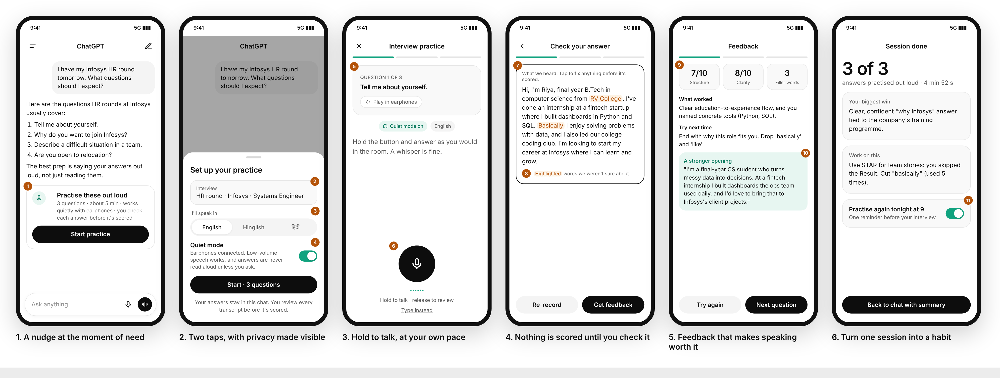
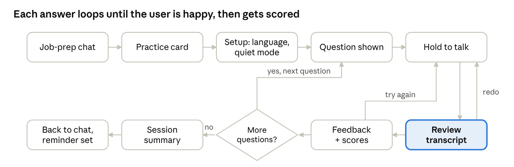

# Practice Out Loud

**Increasing voice input usage on ChatGPT mobile in India.** A product case study that goes from market landscape to user research to a shipped prototype.

**[Live prototype](https://practice-out-loud.vercel.app)** · [3-pager](docs/03-solution/3-pager.pdf) · [Research deck](docs/02-research/research-deck.pdf) · [Landscape deck](docs/01-landscape/landscape-deck.pdf)



## The problem

India already talks to its phone. Voice queries there run at about twice the global rate, WhatsApp voice notes are a daily habit, and about half of Alexa's Indian users mix Hindi and English. Yet few Indian users speak to ChatGPT, even though India is now its largest market.

Research with job seekers (the chosen segment) found the barrier isn't awareness, it's **context and control**:

| Barrier | Share of respondents |
| --- | --- |
| People around me (shared rooms, PGs, offices) | 65% |
| Can't review or edit before it sends | 53% |
| Worried about accent or Hinglish accuracy | 44% |
| Would try voice for mock interviews | 68% |

## The solution

**Practice Out Loud** is a private, reviewable voice mock interview inside ChatGPT:

1. **Discover:** a practice card appears after a job-prep message.
2. **Set up:** context is pre-filled; choose English, Hinglish or Hindi; quiet mode turns on with earphones.
3. **Answer:** hold to talk, one question at a time; "Type instead" is always available.
4. **Review:** edit the transcript, with unsure words flagged, before anything is scored.
5. **Feedback:** scores on structure, clarity and filler words, plus a stronger rewrite.
6. **Return:** the summary is saved to chat, with a reminder before the interview.



**North Star:** weekly voice messages from India = weekly active voice users × voice messages per voice user. The 4-week A/B target takes weekly active voice users among job seekers from 15% to 25%.

## Repository structure

```
.
├── prototype/
│   └── index.html            # single-file clickable prototype (no build step)
├── docs/
│   ├── 01-landscape/         # Milestone 1: voice landscape, UX teardown, KPI tree
│   │   ├── landscape-deck.pdf
│   │   └── slides-source/
│   ├── 02-research/          # Milestone 2: segment, research insights, Problem Framing Canvas
│   │   ├── research-deck.pdf
│   │   ├── research-kit.pdf  # segments, hypotheses, survey, interview guide
│   │   ├── data/survey-responses-mock.csv
│   │   └── slides-source/
│   └── 03-solution/          # Milestone 3: solution 3-pager
│       └── 3-pager.pdf
├── assets/                   # wireframes and user-flow images
└── vercel.json               # serves /prototype on Vercel
```

## Run the prototype

Open `prototype/index.html` in a browser. In Chrome, holding the mic button transcribes your speech live (allow mic access); other browsers play a sample answer. Toggle **Annotations** to see the design notes.

Wireframe export views: `?board=1` (screens 1–3 with notes), `?board=2` (screens 4–6), `?board=3` (all six).

**Deploy:** import this repo into Vercel. `vercel.json` already points the output to `prototype/`.

## A note on the data

The Milestone 2 survey (N = 34) and interview quotes are **simulated**, with mentor approval because of time constraints. Every figure in Milestones 2 and 3 is calculated from `survey-responses-mock.csv`. Market and segment figures in Milestones 1 and 2 come from public sources cited on each slide: OpenAI and TechCrunch, Google India, Amazon India, State of Working India 2026, Apna Interview Readiness Index 2025, and LinkedIn India.

## Author

Chirag ([@chiragpc2004](https://github.com/chiragpc2004))
